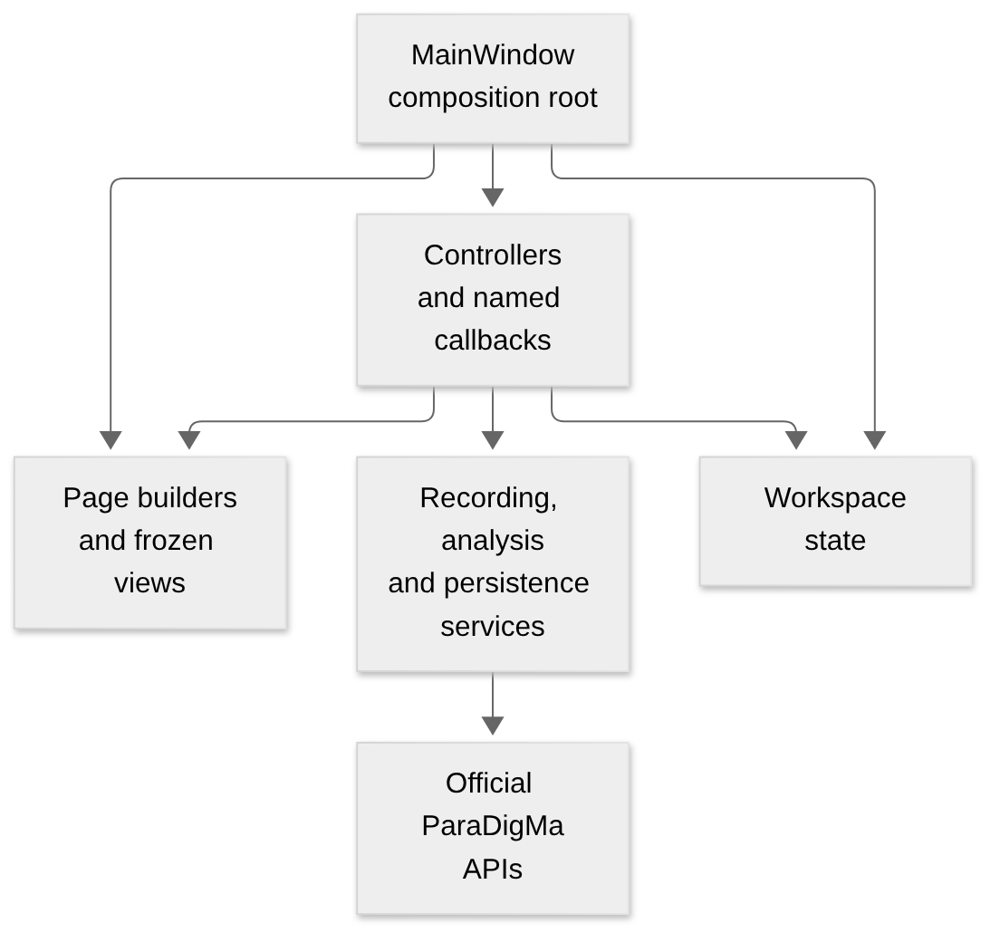
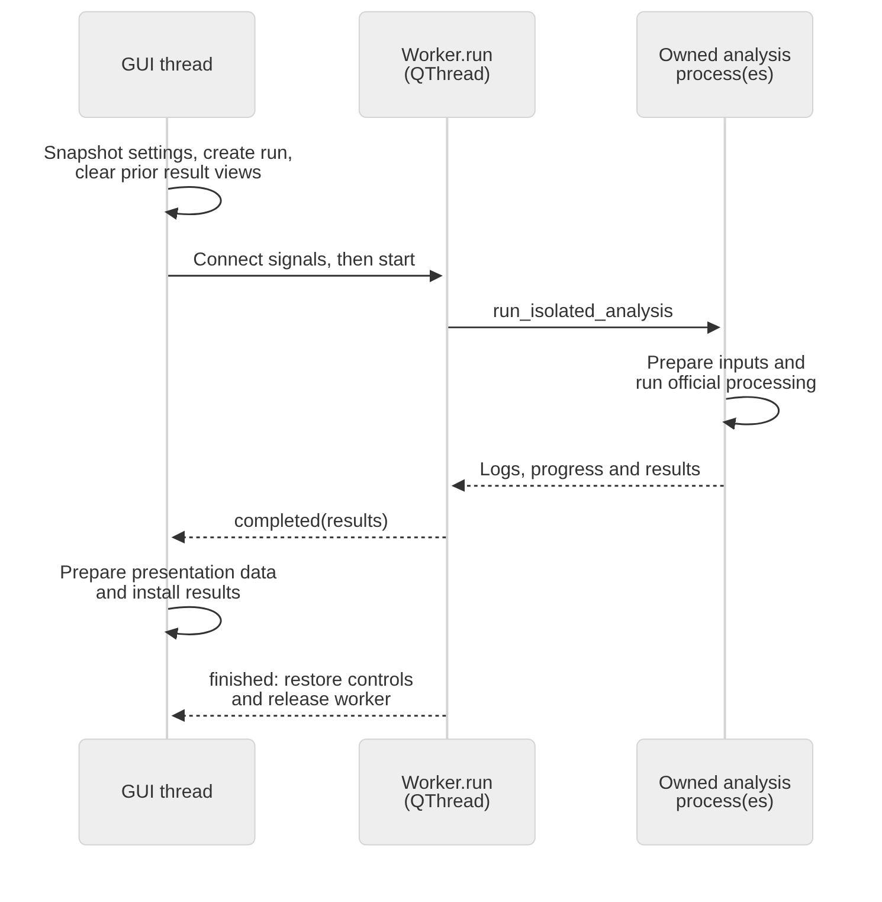

# Application architecture

Studio is a PySide6 desktop application around the official ParaDigMa toolbox.
Controllers coordinate the four pages, background jobs and shared state;
scientific services prepare recordings and call the official pipelines.
This guide describes the current source on `main`.

- [Components and ownership](#components-and-ownership)
- [Startup and Qt lifecycle](#startup-and-qt-lifecycle)
- [Loading, configuration and previews](#loading-configuration-and-previews)
- [Preparation and input contracts](#preparation-and-input-contracts)
- [Execution and cancellation](#execution-and-cancellation)
- [Results and sensor context](#results-and-sensor-context)
- [Graph coordinates, navigation and rendering](#graph-coordinates-navigation-and-rendering)
- [Saving and reopening](#saving-and-reopening)
- [Analysis progress](#analysis-progress)
- [Extending the application](#extending-the-application)

Use the [repository map](REPOSITORY.md) to locate modules,
[Development](DEVELOPMENT.md) for commands and coding policy, and the
[API reference](PYTHON_API.md) for service signatures and the saved-run contract.

## Components and ownership

The arrows below show construction and dependencies, rather than execution
threads. Each controller receives only the state, view and services it needs.

[Editable diagram source](images/architecture/components.mmd). Click the image for full size.

| Component | Responsibility and boundary |
| --- | --- |
| `MainWindow` | Creates state, pages and controllers; connects signals and provides thin Qt receiver adapters |
| Page builders | Construct widgets and expose frozen views/callbacks; graph handles can remain deferred |
| Controllers | Turn user actions and job completions into state changes, service calls and view updates |
| Workspace state | Holds the current inputs, results, run identities and transient UI/cache state |
| Qt-independent services | Load/validate data, prepare inputs/results, run official processing and encode saved data |
| Background execution | Keeps blocking operations away from Qt; returns values and diagnostics through signals |

[`app.py`](../src/paradigma_studio/app.py) is the composition root.
[`workspace_state.py`](../src/paradigma_studio/workspace_state.py) defines the
mutable state objects:

| State | What it retains |
| --- | --- |
| `InputState` | Original loaded frames, source paths and the inspected recording |
| `DataState` | Recording descriptives, raw-graph dirty state and channel colors |
| `AnalysisState` | Manual-origin override state; full Analyze values are owned by the controller and its widgets |
| `ResultState` | Original results, provenance, source alignment, display clock and derived presentation caches |
| `RunState` | Run records and active/current/selected run identities |
| `SensorState`, `GraphState` | Sensor context/navigation, selected markers, linked axes and plot-cache state |
| `JobState` | Active worker lifetime and analysis cancellation event |
| `ShellState` | Sidebar and About-dialog state |

Frozen views make component dependencies explicit; their widgets and DataFrames
remain mutable. Treat original recording and result frames as read-only. A Qt
parent supplies ownership and dialog APIs. Cross-component actions use named
callbacks, and controllers use their declared ports.

The internal `ui/compatibility.py` driver exposes convenience ports to tests,
probes and benchmarks. Application code uses explicit owners and works without
the driver decorator. Its maintenance policy is in
[Development](DEVELOPMENT.md#internal-workspace-driver).

## Startup and Qt lifecycle

Startup creates the shell, page controls, controllers and signal connections.
Pandas, Arrow, Matplotlib and ParaDigMa pipeline imports stay deferred until
needed. Font-cache configuration runs before plotting imports.

Data graphs, Results graphs and sensor context initialize independently through
[`DeferredWidget`](../src/paradigma_studio/ui/deferred.py) and graphics accessors.
Opening a graph or explicitly requesting its graphics builds it once; later
visits reuse it. Building a page or obtaining its frozen view must preserve that
deferral. Callbacks created before their target controllers use deferred calls.

Controllers that receive Qt signals keep GUI-thread affinity. Worker signals
connect before the worker starts; completion installs data before terminal
cleanup restores controls. Preserve the actual receiver methods and connection
ordering when changing wiring.

`AnalysisPage` owns reusable non-modal help windows. They reuse explanation
labels so file-source guidance stays current while open. Opening help leaves the
form geometry fixed. New input and an accepted application close dismiss help;
cancelling a close preserves it.

## Loading, configuration and previews

### Loading a recording or batch

[`DataController`](../src/paradigma_studio/data_controller.py) starts a load job
that reads the files and calculates initial descriptives. The GUI installs the
completed payload, supplies column-name schemas to the mapping editor and resets
Analyze to defaults from the new input. A cancelled picker or failed load leaves
the previous input/configuration in place.

One Analyze configuration applies to an entire batch. Switching the recording
being inspected changes Data's view and diagnostics while retaining the shared
configuration. Studio expects compatible column names, units, time formats and
axis conventions across the batch; metadata warnings do not establish that the
physical recordings match the user's declarations.

### Configuration authority

`AnalysisController` owns the shared settings. File metadata proposes defaults;
the selected control values, including an explicit **Not included**, determine
the processing inputs. `FileDefaults` and the mapping editor track file/manual
provenance.
Data's time controls call the Analyze selection paths and mirror an immutable
`TimeConfiguration` under signal blockers.

Input resets and saved-parameter restoration validate/install settings under one
guard: cancel superseded origin requests, block intermediate widget signals,
apply the complete settings and perform one refresh. Manual origins take
precedence over pending previews. Confirming an unchanged value can update its
provenance without recomputing statistics.

| Event | Main dependent updates |
| --- | --- |
| Module selection | Required signals, watch-side relevance, Run availability and origin preview |
| Signal-column edit or mapping Default | File unit defaults, sensor-unit availability, origin preview and shared Data diagnostics/plots |
| Time-unit edit on either page | Shared value/provenance, origin preview and affected Data diagnostics/plots |
| Acceleration/gyroscope unit edit | Value/provenance; the input clock is unchanged |
| Gap-splitting switch | Availability of gap and minimum-section fields |
| Missing-sample policy | Origin preview |
| New input, restored settings or job completion | One complete controller refresh |

### Preview delivery and clocks

[`CachedPreview`](../src/paradigma_studio/previews.py) debounces requests, reuses a
bounded cache and runs one read-only operation at a time per preview executor.
Generation and request keys prevent obsolete results from replacing the current
request. Cancelling a request does not stop an already-running scan; its result
must respect the current request and manual-origin state. Shutdown prevents
late delivery to a closed workspace.

The selected time column and representation drive diagnostics, analysis timing
and automatic clock previews. An unrelated date column cannot supply a fallback
clock. An automatic calendar origin can come from the selected absolute time or
explicit recording-start metadata. The chosen display origin is retained in
provenance; `plot_time_origin` is removed before scientific execution.

## Preparation and input contracts

[`core.py`](../src/paradigma_studio/core.py) owns Studio's preparation sequence;
[`paradigma_api.py`](../src/paradigma_studio/paradigma_api.py) supplies typed, lazy
adapters to the pinned official toolbox. `preparation_contracts.py` describes
accepted signals, units, axes and numeric time encodings. These types complement
runtime validation; they cannot verify a recording's physical units or mounting.

The GUI path performs these steps for each original recording:

1. Apply authoritative `signal_columns` selections and the source-to-target
   mapping to a separate frame. Unassigned canonical signals cannot provide
   fallback inputs. Reject duplicate target columns and missing required channels.
2. Validate required numeric values and the selected timeline. Apply the chosen
   missing-sample policy; reconstruct a complete difference timeline before
   excluding sensor rows so their time intervals are preserved.
3. Use official preparation functions for unit/time conversion and independent
   accelerometer/gyroscope axis correction. Column mapping handles permutations;
   `axis_inversions` describes signed canonical targets.
4. Apply the chosen gap and minimum-section policy using the official
   segmentation helpers. Pass the resulting contiguous sections separately so
   downstream filtering and feature windows cannot bridge those boundaries.
5. Call `run_paradigma` with prepared inputs, `skip_preparation=True` and
   `split_by_gaps=False` to avoid preparing/splitting a second time. Studio-only
   selection and inversion metadata is removed from that handoff.

Studio also reads official classification exports from a fresh run directory
where ParaDigMa 1.1.2 omits those tables from its orchestrator return value.

This explicit preparation preserves the selected policies because ParaDigMa
1.1.2's raw orchestrator does not forward all preparation options. The GUI has no
preparation bypass. The Python API retains its explicit bypass, literal renaming
when `signal_columns` is absent, and a global `device_orientation` option for
callers without per-sensor inversions.
`watch_side` is forwarded to the official processing path; users supply the
expected input orientation and leave wrist-side adjustment to ParaDigMa.

IMU and pulse processing can form independent groups, retaining successful
outputs and reporting failures from another group. Section/recording identifiers
and timing metadata remain available for later alignment. The
[scientific tests](SCIENTIFIC_TESTS.md) compare the real processing paths with
independent official calls; typed adapters preserve the upstream call contract.

## Execution and cancellation

[`JobController`](../src/paradigma_studio/job_controller.py) permits one foreground
job at a time. It disables conflicting actions, creates a
[`Worker`](../src/paradigma_studio/jobs.py), connects its signals, then starts it.
The controller stays on the GUI thread; `Worker.run` executes the operation in a
QThread. Read-only previews have their own executors.

A normal GUI analysis follows this sequence:

[Editable diagram source](images/architecture/analysis-sequence.mmd). Click the image for full size.

[`analysis_process.py`](../src/paradigma_studio/analysis_process.py) uses one owned
spawned process for a single recording or sequential batch. With multiple
original recordings and sufficient resources,
[`parallel_analysis.py`](../src/paradigma_studio/parallel_analysis.py) directly
owns up to two reusable processes. Gap sections stay with their original
recording. Outputs merge in input order and official pooled aggregation runs on
the combined quantifications. CPU/RAM policy and custom-configuration fallbacks
are defined in `analysis_limits.py`; estimates are not hard resource limits.

The QThread coordinates the owned processes and transfers. Queues carry log and
progress events; parent-created private files carry large payloads. Their pickle
format is an internal trusted-code transfer, separate from user-file loading and
JSON result reopening. See [Security](../SECURITY.md#safeguards-and-trust-boundaries)
for the trust boundary.

Stop sets an event. The coordinating operation observes it, terminates/joins its
owned processes and cleans their temporary files before reporting cancellation.
This process boundary lets Stop end native computation while the Qt thread
finishes its cleanup normally. Unexpected worker failures retain their
traceback and emit one concise failure; pipeline-level errors can coexist with
successful partial outputs. Terminal cleanup stops progress updates, releases
the worker and restores controls.

## Results and sensor context

[`ResultController`](../src/paradigma_studio/result_controller.py) installs the
scientific results, provenance and source alignment. Its `analyzed` completion
path currently also prepares presentation data on the GUI thread. Saved-run
reopening prepares that data in a background job and then calls
`install_prepared` on the GUI thread. These paths share the Qt-independent
[`prepare_results`](../src/paradigma_studio/result_preparation.py) service.

`PreparedResults` and `ResultData` separate original tables from display timing,
coverage, plot frames and interval bounds. Their frozen containers do not make
DataFrames immutable. Optional date/timing columns, percentage scales and
half-hour/day/profile summaries belong to presentation; they must not change
the stored scientific tables. Replacing results invalidates derived views; the
graph renderer resets navigation when it installs the replacement. Overview
installs first; hidden graph construction remains deferred.

`SensorController` uses source alignment and indexed timestamp lookup to select
the relevant original sensor samples. Those samples retain their source units
and channel values. The visible graph window can load new samples without
building its hidden table. Sensor context requires retained source frames;
saved results can reopen without the original recordings.

## Graph coordinates, navigation and rendering

Raw Data and sensor-context graphs convert display coordinates from the selected
time column: absolute Unix values become UTC dates, native datetimes keep their
time zone, and relative/difference/duration values display in seconds. Relative
values keep their origin; cumulative differences include the first increment.
Tables retain the original timestamps. Results use their prepared display clock
and view-specific date/hour/profile formatters.

`TimeToolbar` and `TimeScroll` share bounded time selection, hand dragging,
zoom buttons, scrollbar/trackpad navigation and history across raw and Results
graphs. `RawToolbar` adds source-window loading and visible-sample Y fitting;
`ResultsToolbar` adds result-renderer hooks. Source bounds are applied before
sample loading or redraw callbacks.

The main navigation invariants are:

- Hand dragging translates time only, keeps the visible duration and records one
  settled history step. Mode changes, history/Home, replaced views and lost
  button capture finish the gesture.
- Automatic raw Y limits use finite values from selected visible samples;
  offscreen drawing neighbors cannot affect them. Manual Y limits stay fixed.
- Channel changes retain the time window and manual scales for remaining sensor
  groups. New recordings or time representations reset Data navigation; new
  sensor contexts reset context navigation. Sensor Home retains its initial
  inspection context while its scrollbar can reach the full source range.
- The shared Qt canvas paints the blue interval preview over plots and gaps
  without changing figure data or the exported figure.

`ResultGraphs` owns rendering, axis reuse and viewport restoration;
`result_graph_interactions.py` owns graph/table selection and sensor-context
actions. Results uses one plot scroll area with toolbar, time ruler and footer
outside it. The series tree scrolls independently. Raw drawing summaries and
result caches bound display work while figure exports render the original
visible samples/bars. Cache invalidation must follow source, view, clock and
layout changes. See [Performance](PERFORMANCE.md#current-runtime-behavior) for
budgets, fallback rendering and measurement commands.

## Saving and reopening

[`RunController`](../src/paradigma_studio/run_controller.py) owns run history,
local snapshots and reopening. `ExportController` owns export selection and the
unsaved-close workflow. `history.py`, `serialization.py`, `exports.py`,
`result_integrity.py` and `storage.py` implement the Qt-independent file rules.
The exact envelope, provenance and receipt fields belong in the
[saved-run reference](PYTHON_API.md#saved-run-contract).

Saving snapshots the existing results/provenance in a background job and records
the resulting outputs on completion. It does not rerun analysis. History alone
cannot restore unsaved tables; private in-memory frame/result caches are not
restored from history JSON. Independent saves can succeed even if another fails.

An in-memory run reuses its cached payload. For a disk reopen, a local snapshot
takes precedence over a complete JSON export. Disk reads verify run identity
and checksum against the same bytes they decode. Large JSON files use an owned
reader process through
[`result_reopening.py`](../src/paradigma_studio/result_reopening.py); small reads
remain in the job thread. The child separates the JSON decoder's interpreter
lock from Qt. Presentation preparation completes before GUI
installation, so a failed open leaves the displayed results in place.

Writes protect original sensor files, including companions and aliases. Atomic
single-file replacement and CSV companions have the limits described in the
[security policy](../SECURITY.md#safeguards-and-trust-boundaries); checksums detect
changes but do not authenticate an attacker-controlled file/history pair.

Closing is blocked during a foreground job. Unsaved-close Save starts background
saving and queues the close after successful completion and job cleanup. Failure
keeps unsaved runs and the window open; an accepted close shuts down previews.

## Analysis progress

[`analysis_progress.py`](../src/paradigma_studio/analysis_progress.py) represents
work on a 0–1000 scale. Studio reports preparation, coverage, transfer and assembly
milestones; a read-only adapter recognizes the pinned ParaDigMa INFO stage
messages. Unknown messages leave progress unchanged. Sample counts and stage
weights combine sections, pipeline groups and recording workers using running
totals rather than rescanning sensor values.

Progress travels separately from ordinary log/status messages through the
existing event queues and `Worker.progress` signal. `JobController` rejects stale
workers and cancelled runs, ignores duplicate/backward values and coalesces GUI
updates at 200 ms intervals. It marks the bar full only after the GUI result
installation callback returns. Failures and cancellation stop pending updates;
non-analysis jobs keep the existing busy indicator. These work units are not an
elapsed-time estimate and do not alter scientific settings or outputs.

## Extending the application

Place behavior with its existing owner: page builders construct controls,
controllers coordinate actions, pure services calculate/encode data, and result
renderers derive display views. Use explicit state, frozen views and named
callbacks; preserve lazy graphics construction, GUI-thread affinity and job
ownership. Refer to the [development policy](DEVELOPMENT.md) for annotation,
exception and complexity requirements.

| Boundary changed | Relevant regression coverage |
| --- | --- |
| Composition, driver independence or signal/cleanup ordering | `test_composition_without_facade.py`, `test_composition_order.py` |
| Deferred imports and graph construction | `test_startup.py` |
| Shared settings, file resets and late preview delivery | `test_analysis_refresh.py`, `test_shared_time_configuration.py`, `test_origin_preview.py` |
| Preparation, process isolation or parallel merging | `test_analysis_preparation.py`, `test_parallel_execution.py`, `test_parallel_scientific.py`, `test_scientific_equivalence.py` |
| Graph retention, navigation and rendering | `test_graph_performance.py`, `test_result_navigation.py`, `test_raw_navigation.py`, `test_hand_navigation.py` |
| Snapshot integrity, reopening and close-after-save | `test_result_integrity.py`, `test_saved_results.py`, `test_run_provenance.py` |

The [test guide](TEST_SUITE.md) maintains the complete coverage map. Bounded
individual caches and worker estimates do not bound total session memory:
inactive runs can retain original recordings and result tables. Representative
Windows workloads remain necessary when changing these lifetimes or budgets.
