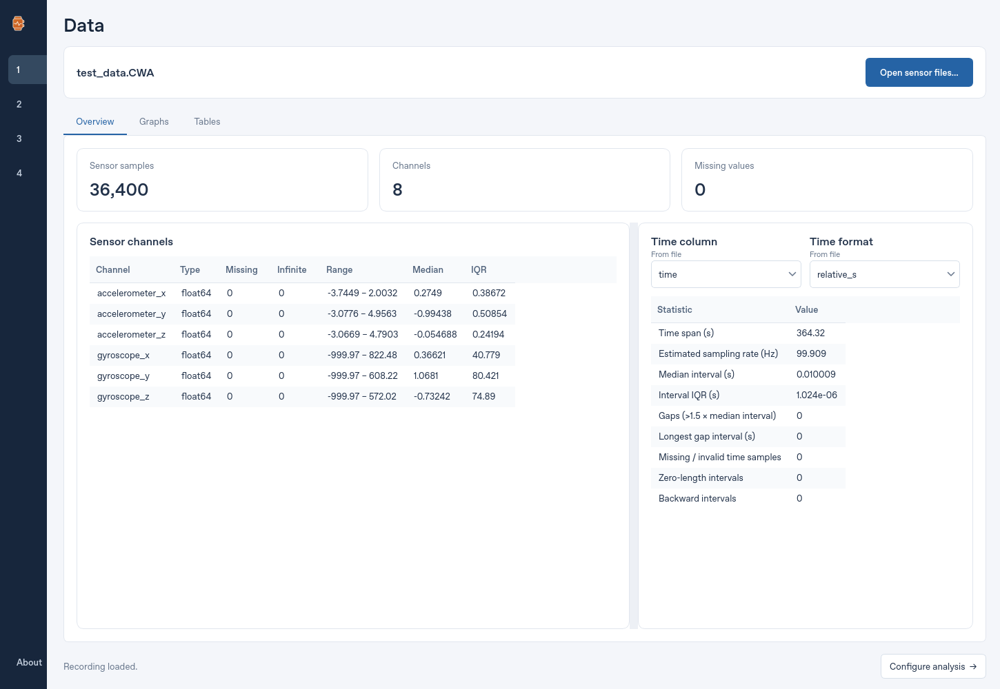
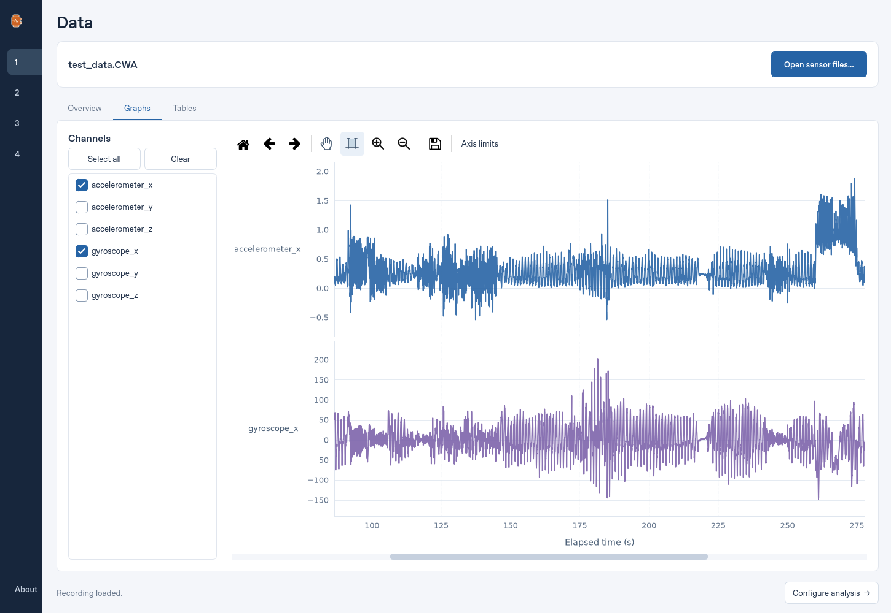
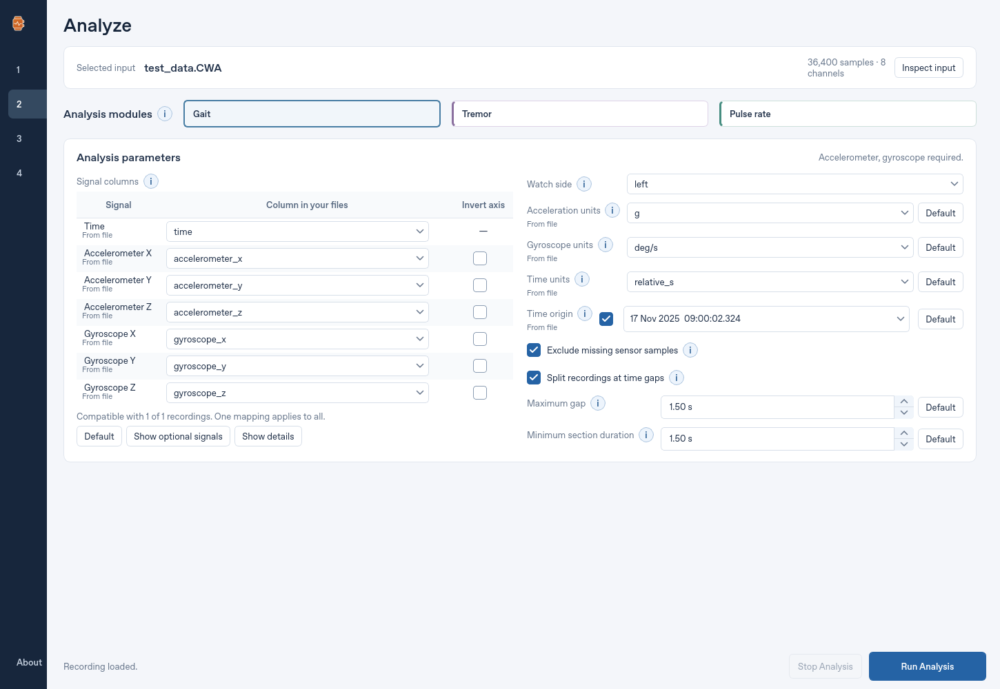
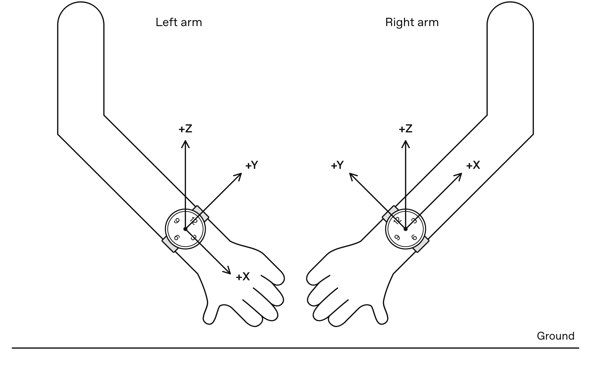
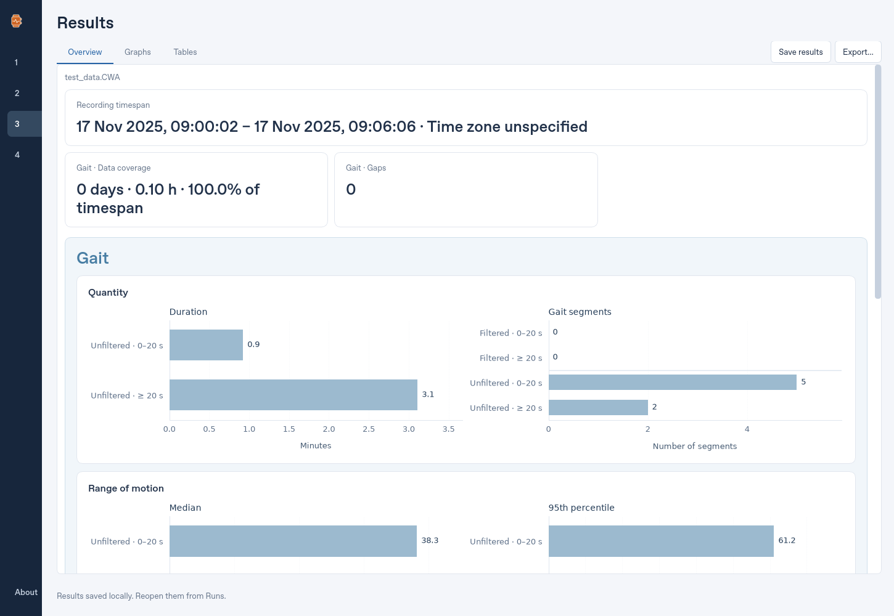
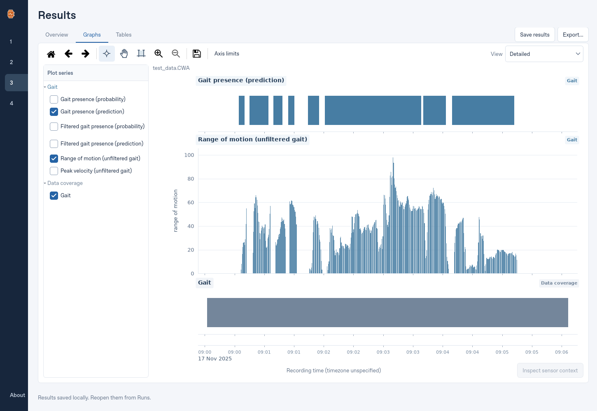
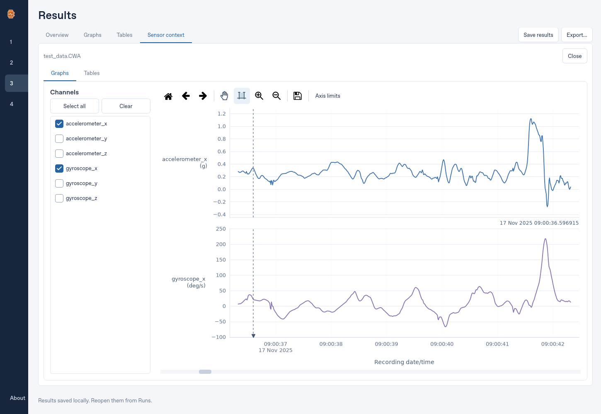
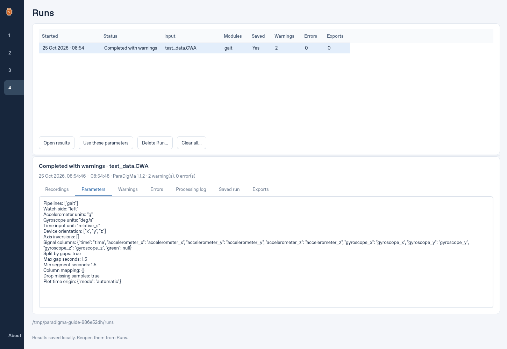

# Using ParaDigMa Studio

Follow the app's four pages: [Data](#data), [Analyze](#analyze),
[Results](#results) and [Runs](#runs). For downloading and opening the Windows app,
start with the [README](../README.md).

The screenshots follow one gait analysis of the public Axivity example included
with Studio. Click an image to view it at full size. Your available signals
and outputs depend on your recording and selected analysis modules.

Navigation, help and keyboard shortcuts

**About**, at the bottom of the sidebar, or **F1**, opens Overview, Citations and
Licences. **Copy BibTeX** in Citations copies the 2026 JOSS paper reference;
pipeline-method and validation publications appear below it. Licences contains
the full Studio and ParaDigMa licences under separate headings.

| Shortcut | Action |
| --- | --- |
| **Alt+1**, **Alt+2**, **Alt+3**, **Alt+4** | Open Data, Analyze, Results and Runs, respectively. |
| **Ctrl+O** | Open recordings. |
| **Ctrl+Enter** | Run analysis. |
| **Ctrl+S** | Save results locally. |
| **Delete**, with run-list focus | Delete selected runs after confirmation. |
| **F1** | Open About. |

## Data

Load recordings, confirm their time representation and inspect the original samples.

*Data Overview after loading the example. The time column and format are read
from the file and shared with Analyze.*

### Load recordings

1. Click **Open sensor files…** or press **Ctrl+O**.
2. Select one recording, or use Ctrl/Shift to select several recordings from
   **the same subject**.
3. For a batch, use the recording selector to inspect each file. Analyze will
   process the entire selection with one configuration.

Use consistently formatted recordings within a batch: source column names,
units, wrist side and axis conventions must support the same settings. Review
the recording configuration even when Studio prefills it.

| Format | What Studio reads |
| --- | --- |
| CSV and Parquet | Table columns and original values. The format alone does not establish sensor units. |
| Pickle (`.pkl`, `.pickle`) | Table data from a trusted source, after confirmation. Pickle files can execute code when opened. |
| TSDF (`*_meta.json` with its binary companions) | Channels, supported units and recording-start metadata. Keep the metadata and referenced binaries together. |
| Axivity CWA | Decoded accelerometer and gyroscope samples, their units and recording-start metadata. |
| Empatica Avro | Supported IMU samples and metadata; gyroscope data may be absent. |

TSDF per-channel `scale_factors` are applied once during loading. Displayed
values and the units you select for analysis refer to these scaled physical
values; absent or empty scale factors leave stored values unchanged. Source
files are never rewritten.

Successfully loading new files resets the analysis configuration and applies
their available defaults. Cancelling the picker or a failed load preserves the
current input. Switching the recording inspected within a loaded batch keeps
the batch's shared settings.

### Confirm the time column and format

**Time column** and **Time format** are the same settings as Analyze's **Time**
signal and **Time units**. Editing either page updates both pages, sampling
diagnostics, raw graphs and the automatic time-origin preview. The selected
column is the clock used for analysis; other date columns do not supply a
replacement clock.

Recognized column names and supported unit metadata prefill the controls.
**From file**, directly below a field name, identifies a file-derived value;
hover over the label for its source. An explicit selection, including confirming
the current value, marks it as manual on both pages. Analyze's **Default**
controls restore file-derived settings.

For numeric timestamps, choose the representation that matches the recording:

| Representation | Seconds | Milliseconds |
| --- | --- | --- |
| Elapsed time relative to a recording origin | `relative_s` | `relative_ms` |
| Absolute Unix timestamps | `absolute_s` | `absolute_ms` |
| Time increments between samples | `difference_s` | `difference_ms` |

A declaration of “seconds” alone cannot distinguish these representations.
Native datetime values carry their own time representation; Data hides the
numeric-format control for those columns. Convert CSV date strings to a supported
numeric representation before analysis.

The time selection applies to every loaded recording. If it is missing in the
file currently inspected, or **Not included** is selected, sampling diagnostics
are unavailable. Studio does not silently choose another column.

### Read the sampling diagnostics

**Overview** separates sensor and time statistics. Scroll the overview in smaller
windows to reach all controls and statistics.

- Sensor range is minimum–maximum. Median and IQR (75th minus 25th percentile)
  use finite original values; missing and infinite values are counted separately.
- Estimated sampling rate is the inverse median positive time interval.
- Diagnostic gaps are intervals longer than 1.5 times that median. This is a
  sampling diagnostic, separate from Analyze's configurable **Maximum gap**.
- Invalid timestamps are not bridged. Zero-length and backward intervals are
  reported separately.

### Inspect graphs and tables

Use **Graphs** to overlay selected channels. Channels of the same modality share
a value axis; different modalities get separate graphs with a shared time axis.
Colors and legends identify the original channels, and values retain file units.
Click a checkbox or its label to toggle a channel, or use **Select all** and **Clear**.
Changing channels keeps the current time window and manual vertical limits for
sensor groups that remain plotted. New sensor groups scale automatically.
**Home** restores the full recording view. Loading another recording or changing
the time column or format starts a new view at its full range.

The graph controls follow Results: drag with **Select time interval** to zoom all
linked graphs to a time window. A translucent blue band previews the selected
interval across the graphs and their gaps. **Zoom in (+)** and **Zoom out (−)**
halve or double the visible time span. A horizontal scrollbar appears when zoomed
in and moves that window through the recording; horizontal trackpad gestures or
Shift+wheel also move time. Zoom out stops at the full recording view.

Y axes automatically fit the selected channels' finite samples in the visible
window after navigation settles. To keep a fixed scale, open **Axis limits**,
click the relevant graph and turn off **Automatic** for Y. Manual Y limits stay
fixed through time navigation and channel changes; turn Automatic back on to
resume fitting. **Back / Forward** restores earlier views. Save figure exports
the visible interval using the original samples.

*The same recording's original acceleration and angular velocity, with separate
value axes and a shared time window controlled by the horizontal scrollbar.*

Zoom in to see individual samples at their original timestamps. Wide views
preserve peaks while limiting display to 20,000 samples per channel; zooming
restores detail in the visible range. **Tables** retains all original samples.
See [graph controls](#navigate-and-adjust-graphs) for navigation and axis limits.

Absolute Unix timestamps and date/time columns use **Recording date/time**, with
the same date and time formatting as the Results sensor graphs. Unix timestamps
use UTC; date/time columns retain their time zone when one is stored. The visible
range determines whether ticks show hours, seconds or milliseconds, with dates
at the first visible tick and at day changes.

Relative timestamps, time increments and duration columns use **Elapsed time (s)**.
Milliseconds are converted to seconds. Relative timestamps retain their original
origin; increments are accumulated across the complete column before display
sampling. **Axis limits** and graph exports use the displayed representation.
**Tables** retains the original timestamps and increments. If a complete timeline
cannot be reconstructed, graphs use sample positions rather than invented times.

### Import issues

**The extracted app does not start:** Keep the entire downloaded app folder,
including `_internal`. Extract updates into a fresh folder. See the
[README](../README.md) and [Windows signing guidance](../SIGNING.md) for download
and publisher-verification information.

## Analyze

Choose analysis modules and confirm how Studio should interpret the loaded recordings.

*The example is configured for gait. Signal columns and units are prefilled from
the recording; wrist side and axis direction still need review.*

### Choose modules

Select any combination in **Analysis modules**:

| Module | Required signals |
| --- | --- |
| Gait | Time, three accelerometer axes and three gyroscope axes. |
| Tremor | Time and three gyroscope axes. |
| Pulse rate | Time and raw Green PPG. Accelerometer channels are optional. |

For gait, set **Watch side** to the actual wrist. It is inactive for tremor or
pulse rate alone. ParaDigMa adjusts for left/right wrist differences during
processing. Do not apply that wrist-side adjustment yourself; use the expected
input orientation below when mapping the original recording's axes.

Pulse rate in ParaDigMa 1.1.2 assesses quality using PPG features only;
`pred_sqa_proba` does not include an accelerometer motion assessment. Complete
optional accelerometer channels still receive the selected unit conversion and
missing-sample checks.

### Map signal columns and axes

The **Signal columns** table appears on the left, with other parameters on the
right; narrow windows stack the sections. Open its **i** explanation for the
guidance and figure below.

Choose the column in your recordings that supplies each signal. Dropdowns list the available columns, and only your selections are used for analysis. Select **Not included** to leave a signal unassigned.

Studio automatically matches column names shared by all loaded recordings. **From file** marks each automatic match. You can change any selection; **Default** restores the automatic matches for all signals, including optional signals, while keeping your axis inversions.

One set of column selections and inversions applies to the whole batch. Check that column names and axis conventions are consistent across your recordings. Loading new files resets Analyze and prefills available settings from the new input.

Map your recording’s accelerometer and gyroscope columns to the positive axis directions shown for the wrist on which the sensor was worn. Use **Invert axis** where a source axis points in the opposite direction.

Select the actual **Watch side**. ParaDigMa adjusts for left/right wrist differences during processing. **Do not apply that wrist-side adjustment yourself**—provide the data in the orientation illustrated above.

**Show optional signals** reveals additional channels. The compatibility summary shows which recordings have the signals needed by the selected modules. Click a warning icon to read its explanation, or use **Show details** for matching and compatibility information. If a previously selected column is unavailable, choose a replacement or **Not included**; its warning identifies the missing column.

[ParaDigMa documentation · Coordinate System guide](https://biomarkersparkinson.github.io/paradigma/guides/coordinate_system.html)

### Review units and file-derived values

Check units against the source recording. Acceleration is displayed as **g** or
**m/s²**; choose the appropriate gyroscope units and time representation too.
Acceleration and gyroscope unit fields are greyed out when none of that sensor's
axes is mapped to an available column. Mapping an axis enables its unit field.

Studio prefills supported units only when metadata agrees across applicable
recordings. TSDF provides per-channel declarations after physical scaling;
Axivity CWA and Empatica imports provide their decoded output conventions.
Plain CSV, Parquet and pickle files do not establish units just from their format
or numeric values.

**From file** below a parameter name identifies a detected value. Hover over the
label or open **i** to see its source. Unmarked values need your review too.
Editing a field makes it manual for the current recording or batch; **Default**
restores its detected value. Unit detection follows the selected source columns.

A single notice summarizes conflicting or incomplete unit declarations across
recordings. It does not block analysis: the selected units apply to every file.
If the actual units differ, normalize the recordings or analyze them separately.
Watch side, axis directions and preparation policies remain user choices.

### Confirm the time origin

**Time origin**, after Time units, controls how recording time is presented:

- For absolute numeric time, the automatic origin comes from the selected
  **Time** column.
- For relative or difference-based time, it comes from declared recording-start
  metadata when available, including TSDF, Axivity CWA and Empatica imports.
- Other date columns do not supply an origin. Without an available origin, the
  field shows **Not set** and results use elapsed time.

Enter a calendar date/time to override the automatic origin. **Default** restores
the derived value; uncheck the field to use elapsed seconds. Time origin changes
presentation only and is saved with the run parameters. Known timezones, clock
precision and daylight-saving offsets are retained.

### Set missing-sample and gap policies

Studio prepares inputs from your selected columns, units and axes automatically.
Matching units and axes need no conversion. Source recordings stay unchanged;
official resampling, filtering and watch-side processing still run as usual.

| Setting | Effect |
| --- | --- |
| **Exclude missing sensor samples** | Enabled initially. Excludes rows with non-finite required sensor values; uncheck for strict rejection. Counts are logged and included in exported metadata. |
| **Split recordings at time gaps** | Enabled initially. Processes continuous sections independently. |
| **Maximum gap** | Maximum allowed interval between samples before splitting; initially 1.5 seconds. It is not a feature-window length. |
| **Minimum section duration** | Minimum duration retained by preparation when splitting; initially 1.5 seconds. Accepted sections may still be too short for a module to produce outputs. |

Each threshold's **Default** button restores its value, including when splitting
is disabled. Non-finite relative or absolute timestamps can also be excluded.
Missing time differences cannot be excluded, because elapsed time would be lost;
retained timestamps must be strictly increasing. Difference-based time is
accumulated before missing sensor rows are removed.

The **i** buttons explain individual fields and link to the official documentation.
Each opens a separate help window, keeping the parameter fields in place. You can
keep the explanation open while editing settings; opening another explanation
replaces the previous one. Use **Close**, **Escape** or the window's close button
to dismiss it. Long explanations and the Signal columns orientation figure can
be scrolled within the help window.

Scrolling over closed dropdowns, numeric fields or date/time controls scrolls
their surrounding page without editing values, even when a field has focus. Use
typing, keyboard arrows or field buttons to edit. An open dropdown list can still scroll.

### Run or stop analysis

1. Review the selected modules, source columns, units, wrist side and axis directions.
2. Click **Run Analysis** or press **Ctrl+Enter**.
3. Review progress in **Runs**. Results opens when processing completes.

**Run Analysis** stays below the settings while the page scrolls. During processing,
**Stop Analysis** remains available there. Stopping terminates the owned analysis
workers, removes temporary processing files and records **Cancelled** in Runs.

Each recording is prepared and processed separately: filtering and feature windows
never cross file boundaries. A batch uses up to two workers when CPU and available
RAM permit; a single recording uses one worker, including its gap sections.
The processing log explains worker selection using detected CPUs, free RAM after
loading, recording size and estimated RAM per worker.

Outputs are combined in input order with unique gait segments. ParaDigMa computes
aggregates from the combined quantifications, rather than averaging per-file
percentages. Detailed tables and exports retain file identifiers (`file_key`).
Runs and JSON exports retain the corresponding source paths.

Selecting pulse rate together with gait or tremor runs separate official IMU and
PPG workflows with their own sensor requirements and missing-sample exclusions.
If one workflow fails, the other's available outputs remain accessible. Review
**Warnings** and **Errors** in Runs. Studio uses official preparation and pipeline
functions; see the [scientific validation](SCIENTIFIC_TESTS.md) for equivalence checks.

### Empty or partial output

Empty output is distinct from a failed run. A short recording or too few detected
tremor windows can leave aggregation unavailable while retaining window outputs.
The default PPG quality classifier can reject a recording's windows, producing no
pulse estimates. Review Runs before interpreting an empty graph.

The public Physilog example contains missing gyroscope samples. Keep exclusion
and gap splitting enabled to process its valid continuous sections. Exclusion
counts appear in the log and preparation metadata (`metadata.desktop_preparation`).
Device compatibility, sampling rate, duration requirements and interpretation
follow the [official ParaDigMa documentation](https://biomarkersparkinson.github.io/paradigma/).

## Results

Review aggregate outcomes, explore their timing and inspect the original signals.

*Overview summarizes the completed gait run. Graphs and Tables provide timing and
individual outputs; Save results and Export are available from every Results tab.*

### Read Overview

**Overview** shows official aggregates and relevant metadata in module cards.
Recording summaries report timespan, covered days and hours, coverage percentage
and gaps. Identical workflow summaries are shown once.

- **Gait:** Quantity, Range of motion and Peak velocity charts are grouped by
  filtered/unfiltered gait and duration category. Quantity shows minutes and
  integer segment counts; segment-count bins use original unfiltered durations,
  with 20 seconds in the ≥20-second bin. Other bar labels use one decimal, except
  CV ratios, which use two. Individual segment records remain in metadata exports.
- **Tremor:** Measures include tremor during rest, power and percentage of time
  with the arm at rest, displayed with two decimals. Tremor percentage uses the
  resting-window denominator; arm-at-rest percentage is resting windows divided
  by all quantified windows.
- **Pulse rate:** **Pulse-rate estimate availability (%)** is the returned estimate
  count divided by the number of complete 2-second epochs in the full recording
  timespan, multiplied by 100.
  That timespan includes gaps and excluded edges, including between-file gaps.
  A final partial epoch is not counted. Hover for both counts. This measures
  availability, not the proportion of high-quality PPG samples. Unknown timing or
  a timespan under two seconds leaves it unavailable. Original counts remain saved.

Display rounding does not alter underlying outputs, exports or official aggregates.
Overview values and pulse-availability percentages survive reopening without
the original sensor files.

### Explore Graphs

Open **Graphs** and check metrics in **Plot series**. Click module headings to
expand or collapse their metrics. Graphs follow that selection order and share
one time axis, which stays visible while you scroll through the graph list.

*Graphs links selected output series to a shared recording timeline. View changes
the presentation; tables and official aggregates keep their original values.*

The initial selection includes gait presence, filtered gait range of motion and
tremor presence when available. Tremor exposes checked presence, arm-at-rest
predictions and power; duplicate predictor columns remain in tables.

Time and date appear on separate lines. The display uses the selected clock and
Time origin configuration. Multiple recordings use actual offsets when all clocks
are comparable; otherwise a labeled **File-order timeline** avoids invented dates
or between-file gaps. Scientific timestamps are unchanged. ParaDigMa's internal
`nr_valid_days` uses its own quantification timestamps independently of this display.

### Choose a graph view

**View**, at the right of the toolbar, changes all result graphs together:

| View | What it shows |
| --- | --- |
| **Detailed** | Individual output intervals and predictions. Zoom in to resolve them. |
| **30-minute epochs** | Continuous medians and binary percentages per half-hour. |
| **Day** | Summaries per calendar day, or elapsed 24-hour blocks without a calendar clock. |
| **24-hour profile** | Mean half-hour summaries across days, arranged from 00:00 to 24:00. |

Day needs at least 14 minutes 24 seconds of valid data per metric. The short
recording illustrated here therefore has no Day summaries.

Missing or non-finite outcomes leave gaps. Actual zero values remain included.
No interpolation bridges missing outputs or recording sections. Graph summaries
change presentation only; zooming and view changes never recalculate official
aggregates or filter table rows.

How individual intervals and predictions are drawn

Continuous outputs use bars at their update cadence. When many bars fit within
one pixel, their extents preserve peaks and density; zooming resolves individual
bars. Pulse-rate estimates cover 2-second intervals, while high-quality PPG
probabilities cover 1-second intervals.

Gait arm-swing positions are evenly spaced bin midpoints within an official
segment, with bars confined to those bins. **Timing details** and sensor context
identify these positions as **Estimated**. Unknown boundaries leave timing
unavailable; measured values remain exact.

Binary predictors use filled spans for positive states only. Each span ends at
the next update, capped at the module cadence (4 seconds for default tremor),
rather than covering the full overlapping feature window. Zero and missing
states remain blank; every output row remains in the tables.

Gait presence indicators compare each window's probability with its bundled
model threshold. Filtered-positive intervals are restricted to detected gait.
These indicators differ from ParaDigMa's final sample segmentation, which also
averages overlapping probabilities. Raw probability columns remain in tables.

**Data coverage** shows prepared samples actually passed to each pipeline,
including exclusions and discarded sections. Identical workflows share a track;
different IMU and PPG coverage is separate. Each sample covers one nominal sample
interval; gaps over 1.5 times the median positive interval remain blank. An
isolated sample with unknown cadence is a tick. Coverage is not a physiological
prediction.

How epoch, daily and profile summaries are calculated

Tremor-power summaries use `log10(power + 1)`, matching ParaDigMa's aggregate
transformation. Epoch medians are calculated after transformation, with the log
scale named on the axis. Tables and data exports retain raw power.

**30-minute epochs** align to calendar half-hours when a clock is known, or
elapsed half-hours otherwise. Gait range of motion and peak velocity require at
least 90 seconds of corresponding filtered or unfiltered gait presence in each
epoch. Tremor power requires 90 seconds of checked tremor presence. Overlaps count
once; partial epochs use the same threshold. Known gait-segment boundaries can
supply presence when classifications are unavailable; unknown presence leaves
the median blank. Data coverage is covered time divided by recording span within
the epoch, including partial edges.

Gait and filtered-gait percentages share one observed-time denominator; filtered
gait cannot exceed gait. Gait-positive time without filtering results is excluded
from both denominators. Other binary percentages use finite observations.

**Day** uses midnight-to-midnight in the recording's display timezone, including
daylight-saving changes. Each metric needs at least **864 seconds (14 minutes
24 seconds)** of valid data, 1% of a 24-hour period. This fixed threshold also
applies to partial and daylight-saving days. Both zero and one predictions are
available binary data; non-finite outcomes are not. Overlaps count once and gaps
are preserved. Gait measurements use estimated within-segment intervals; missing
swing values add no coverage. Data coverage is prepared time divided by the full
calendar day. This rule is separate from the 90-second epoch presence rule.

**24-hour profile** has 48 half-hour slots. Each is the arithmetic mean of valid
daily epoch summaries: percentages for indicators and coverage, epoch medians
for continuous values. Each day has equal weight, regardless of sample count.
The 90-second epoch presence rules apply before averaging; the Day view's 1%
threshold does not. Missing epochs are excluded, valid zeros included, and slots
without qualifying days remain blank.

Profile slots use the source timezone without assuming one if it is unspecified.
A repeated half-hour during a daylight-saving fallback contributes its mean once
for that day; a skipped spring-forward slot is missing. Without a calendar clock,
slots use elapsed 24-hour periods starting at analysis zero. Clicking a profile
bar selects its slot and shows the contributing-day count. It does not select
one dated sample; use another view or Tables for sensor context.

### Navigate and adjust graphs

Results starts in **Select timepoint** mode. Click a bar to mark its time and
values; the selected date/time appears above the pinned time axis.

| Control | Action |
| --- | --- |
| **Select time interval** | Drag across a graph or the gaps between graphs to zoom all linked plots to that time interval. |
| **Zoom in / Zoom out** | Halve or double the visible time span. |
| Horizontal scrollbar | Appears after zooming; moves the visible interval through the full recording. Horizontal trackpad gestures also move time. |
| **Home / Back / Forward** | Restore the full range or navigate view history. |
| **Axis limits** | Set X limits for linked plots and Y limits for the clicked plot. |
| Save figure | Save a 600-DPI image; result figures include the time axis. |

New results and graph-view changes start at the full time range. Adding or
removing graphs preserves the current zoom. Vertical gestures scroll the graph
list using its single right-hand scrollbar. The toolbar and time axis stay visible
in small windows, and **Plot series** scrolls independently. Zooming does not extend
beyond the full recording range.

In **Axis limits**, click the graph to adjust, uncheck **Automatic**, enter bounds,
then press Enter or leave the field. Calendar limits accept ISO date/time with a
timezone; profile X limits accept HH:MM or seconds since midnight. The selected
graph is shaded. **Reset limits** restores automatic bounds; **Close** dismisses
the panel. Manual Y limits stay fixed through scrolling and zooming. Automatic
limits fit visible values, including prediction and coverage percentages, rather
than always using 0–100%. Unedited limits keep full precision even though fields
show at most three decimals.

Detailed and epoch views mark midnight across plots. Date labels adapt to the
available space and zoom; Day shows dates and years, or Day 1, Day 2, etc. without
a calendar clock. Figure exports retain these labels. In profile view, Home and
Reset limits restore the full 24-hour range.

Data and sensor-context graphs use the same time controls and start in
**Select time interval** mode. Automatic Y limits follow visible samples; manual
Y limits stay fixed. In sensor context, zooming out or scrolling can load samples
beyond the initially inspected window, up to the recording boundaries. Home and
Reset limits restore the original inspected window; Back can return to the
preceding view.

### Inspect Tables

**Tables** groups Gait, Tremor and Pulse rate into module-colored tabs.
Choose a classification, quantification or aggregation table with **Output table**.
Original columns and values are the default. **Timing details** adds display-only
clock and gait annotations. Aggregation dictionaries appear as ordered
measure/value tables. Graph zoom does not restrict rows or recalculate aggregates.

### Inspect sensor context

Select a result row or click a result bar, then choose **Inspect sensor context**
at the bottom right of Graphs. The original recording must still be available in
the session; saved results alone cannot supply original samples.

*Sensor context for an estimated gait measurement opens the complete official
segment, with original source values and the selected time marked.*

Ordinary output selections open up to 10 seconds before and after the selected
time, bounded by the recording. Gait measurements open their complete official
segment, instead of treating estimated arm-swing positions as observed events.
A vertical marker identifies the selected time whenever it is visible.

The context opens as a Results tab with **Graphs** and **Tables**. Choose original
channels as on Data; sensor axes use the units stored with that run. Channel
selections are retained between inspections, and changing channels preserves the
time window and manual vertical limits for sensor groups that remain plotted.
Use the same time-interval selection, zoom buttons and horizontal scrollbar as
on Data and Results. The scrollbar spans the source recording, so you can move
beyond the initial context; more original samples load as needed, with gaps kept
blank. Automatic Y limits fit the visible channels, and manual limits stay fixed.
**Home** returns to the original context or full
gait segment. **Close**, beside the recording summary, dismisses the context tab.

### Save results

Click **Save results** on any Results tab, or press **Ctrl+S**, to store the complete
run locally. Saving runs in the background and includes outputs, metadata and
analysis provenance. Original recordings are not copied. New Windows
installations use `%LOCALAPPDATA%\ParaDigMaStudio\runs\results`.

Use [Runs](#runs) to reopen a saved result after restarting. Tables, Overview and
graphs can reopen without the source files; original-sample context requires the
source recording in the session.

Closing with unsaved results offers **Save**, **Discard** or **Cancel**. Save stores
all unsaved runs before closing. An export is separate from a local save and does
not clear the unsaved-results warning.

### Export results

Click **Export…** on any Results tab, select the desired output tables and metadata,
and choose a format:

| Format | Contents |
| --- | --- |
| **JSON** | One structured file with selected outputs and provenance. Non-finite numbers become null. Select all outputs and metadata to preserve complete timing and drill-down information. A complete JSON export recorded for the run can reopen through Runs. |
| **CSV** | One selected table becomes a CSV file plus a `.csv.metadata.json` companion. Multiple tables or metadata selections produce a ZIP with separate CSVs, selected metadata JSON and provenance. |

Saved results and export metadata record both the **Studio version** and the
official **ParaDigMa version** that performed the analysis, plus the Studio build
commit when available. These stay unchanged when you reopen or export a run in
a newer app. Keep a standalone CSV and its metadata companion together; the
companion also contains a checksum identifying the exact exported CSV.

Scientific tables retain original columns and values. Formula-like CSV text is
neutralized for spreadsheet safety. Exports cannot overwrite selected source
recordings. Saved results and exports preserve the mapping and inverted channels;
there is no need to edit JSON to configure signals.

## Runs

Review what happened in each analysis, reopen saved results or reuse its configuration.

*The same analysis is saved and Completed with warnings. The list shows warning
and error counts; the detail tabs explain them and retain the parameters.*

### Review an analysis

Select a row to inspect its details:

| Tab | Contents |
| --- | --- |
| **Recordings** | Input filenames and paths. |
| **Parameters** | The configuration used for that run. |
| **Warnings / Errors** | Separate diagnostic messages, matching the counts in the run list. |
| **Processing log** | Progress, preparation details, worker selection and diagnostic output. |
| **Saved run** | Availability and location of the complete local result snapshot. |
| **Exports** | Locations of separately exported files. |

**Saved** in the run list indicates a local result snapshot; **Exports** counts
user exports separately. Run history stores status, parameters, diagnostics and
these locations in `%LOCALAPPDATA%\ParaDigMaStudio\runs` on new Windows installations.
History alone does not preserve unsaved result tables.

The run summary displays the Studio and official ParaDigMa versions used for
that analysis. The **Exports** detail also lists CSV metadata companions.

A completed run can contain warnings; partial results can include both successful
outputs and failed workflows. **Cancelled** records a requested stop without
treating it as an analysis error. Inspect the messages before interpreting
missing or partial outputs.

### Reopen results

Select a run and click **Open results**. If only a recorded JSON export is
available, the action offers **Open exported results** instead. A local save takes
precedence. Opening runs in the background and returns to Results Overview;
graphs are built when you open Graphs.

Snapshots and JSON exports identify their owning run, and history records each
file's SHA-256 checksum. Opening verifies both. A replaced, edited or unrelated
file cannot reopen under the original run; a failed open leaves displayed
results intact.

Current history and result JSON use **Studio format version 2**, separately from
the app and ParaDigMa versions. Unversioned or unsupported files cannot reopen;
re-analyze the original recordings to create new results. Unsupported history
entries are reported without changing or deleting their files, while supported
runs remain visible. Studio does not discover history in the earlier
`ParaDigMaDesktop` directory.

### Reuse parameters

Load the intended source recording or batch on Data, select a run, then click
**Use these parameters**. Review Analyze before running: restored parameters
apply to the **currently loaded input**, not automatically to the old source.

Restored units and signal choices remain explicit, even when equal to file
defaults. Data's shared time controls update too. Use the appropriate **Default**
control to restore a file-derived value. Loading new files afterwards resets
these restored settings along with other manual edits.

### Delete runs

Use Ctrl/Shift to select runs and choose **Delete Run(s)…**, or press **Delete**
while the list has focus. **Clear all…** removes every run after confirmation.
A confirmation lists the associated result files and exports to be permanently
removed with the entries.

Original sensor files, TSDF companion files and exports referenced by another
run are protected. Running jobs cannot be deleted.
