# ParaDigMa scientific workspace

These screenshots show the native Qt development build using public sensor examples bundled with ParaDigMa. Windows executables are built and checked by the repository's GitHub Actions workflow.

## Data

Overview shows sample counts and separates sensor-channel descriptives from time-channel statistics. Sensor ranges, medians and IQRs use finite original samples. Sampling rate is estimated from the median positive time interval; the displayed gap threshold is 1.5 times that interval. Numeric time units are explicit, and invalid timestamps are not bridged. The recording metadata box has been removed. The panels stack in compact windows.

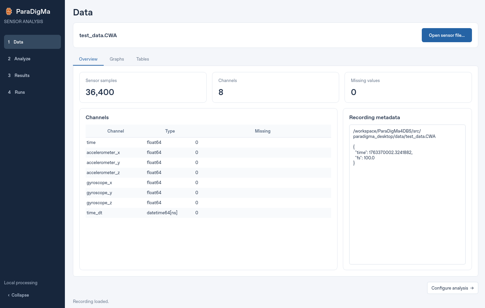

Graphs supports checkboxes for multiple channels, Select all/Clear, stable distinct colors and a legend. Values remain in their original file units; no normalization is applied. Continuous displays are limited to 20,000 points per channel; binary indicators show every positive detection at its original timestamp. Tables and exports retain all samples.

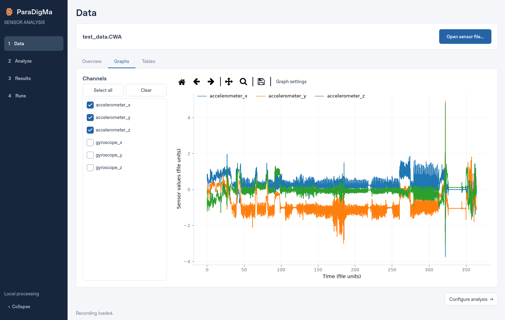

Each graph has one inline **Graph settings** panel for title, axis labels,
grid and legend. Expand **Axis limits** for manual bounds. Pan, zoom, reset
view and figure saving stay on the toolbar. Saved figures retain their own time axis.
The two generic figure dialogs have been removed.

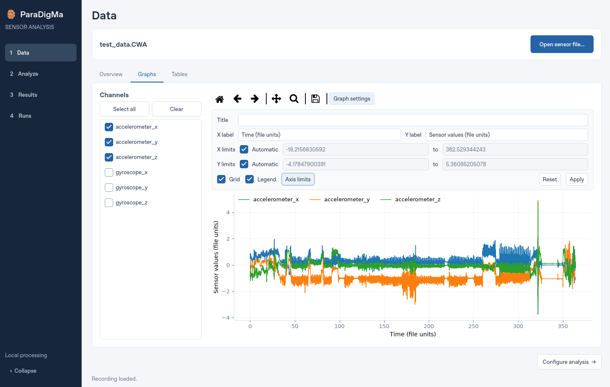

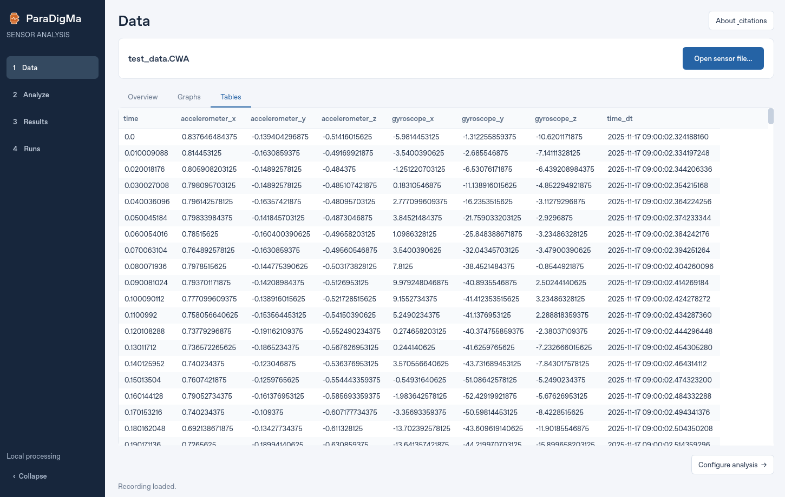

## Analyze

Select any combination of gait, tremor and pulse rate. All settings are in one compact Analysis parameters panel, with uniform circular **i** buttons for inline documented guidance. Default controls fit without scrolling at the minimum window size; expanded help can scroll. Axis and column-mapping examples make the mapping direction explicit. The Run Analysis button remains visible when the page scrolls. Combined IMU/pulse selections run two official workflows in the background and retain successful outputs if another workflow fails.

Gap splitting, maximum gap and minimum section duration are grouped together. Splitting defaults to off; both thresholds default to 1.5 seconds, matching the official package, and each has a **Default** button. **Already prepared** is the last field.

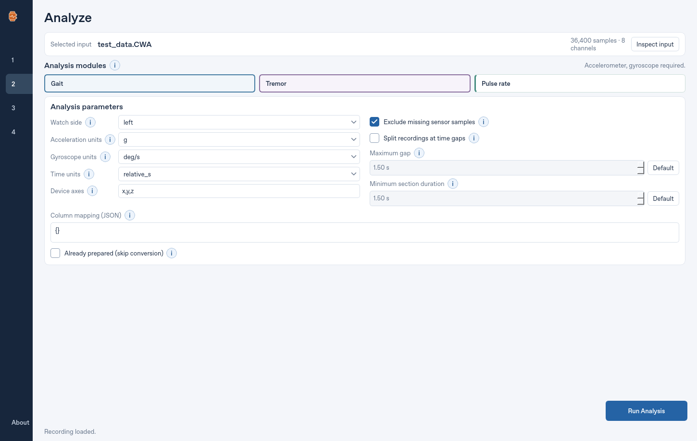

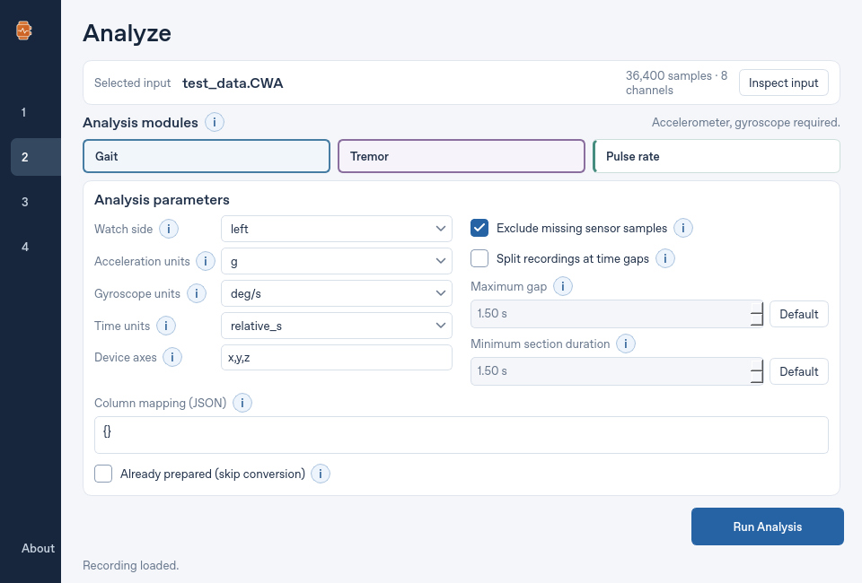

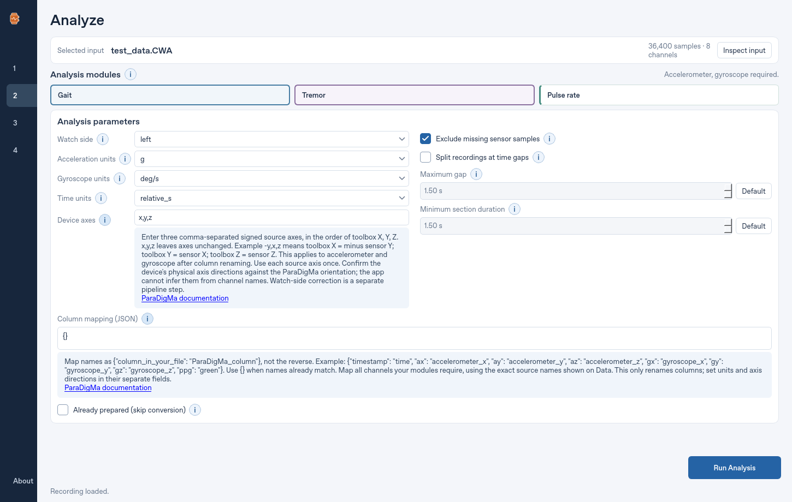

## Results

Overview, Graphs and Tables stay in one fixed tab row near the page heading. Export and filter buttons sit alongside the tabs; the recording name and view controls sit below. Scrolling each view leaves navigation in place.

Overview shows official aggregate values and relevant metadata grouped into module
cards. Gait segment metadata is summarized by counts and duration distributions;
individual segment records are reserved for detailed inspection. Detail filters
do not replace the official aggregate values with selection statistics.

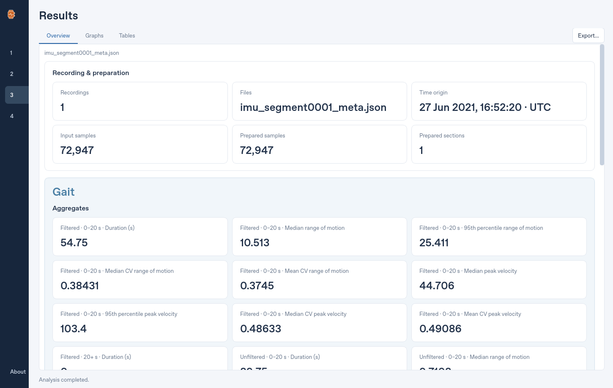

Graphs contain classifications and quantifications. The Plot
series tree supports multiple modules and metrics simultaneously, with vertically
aligned plots sharing recording date/time. A pinned time axis stays at the bottom while graphs or filters scroll and follows pan, zoom and time selections. Dates come from source timestamps or
metadata; files with only elapsed time can use a user-supplied time origin.
Gait points are estimated within explicit segment boundaries and labeled as estimates.
Plot series is the sole graph selector. Graphs use a consistent palette, subtle
grids and shared bottom time labels; scrolling works over the graph canvas.
Binary predictors show slim filled bars at the output update cadence, with compact rows and no redundant vertical-axis label. Positive intervals remain filled when zoomed in; recording gaps, zero and missing states stay blank. The checked-tremor plot reports its checked/resting-window counts and percentage for the current selection. Selected Plot series text stays dark and readable on a pale background, including on hover. Analyze module buttons, overview cards and result series share muted blue (gait), purple (tremor) and teal (pulse rate).

Gait Classification includes probabilities and window presence indicators, using
the bundled detection/filtering thresholds shown in their labels. These are
window comparisons, distinct from ParaDigMa's final labels based on averaging
overlapping windows. Original tables and exports retain their official columns.

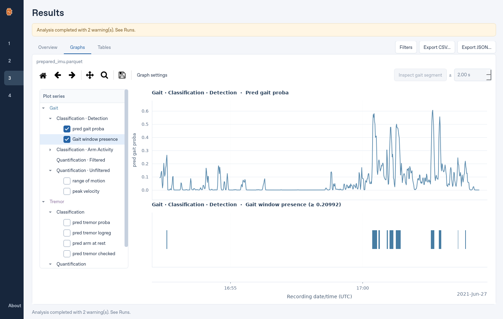

**Inspect sensor context** and its radius sit at the right of the figure toolbar, leaving the space above the time axis for graphs. Selecting a point or table row shows a shared vertical time marker, highlights its plotted values and labels the selected row/time on the pinned axis. Estimated gait positions remain explicitly labeled.

Filters contains only Time origin and From/Until. Calendar and clock selectors
use the recording timezone when known. Recordings without dates use elapsed
seconds until a time origin is supplied.

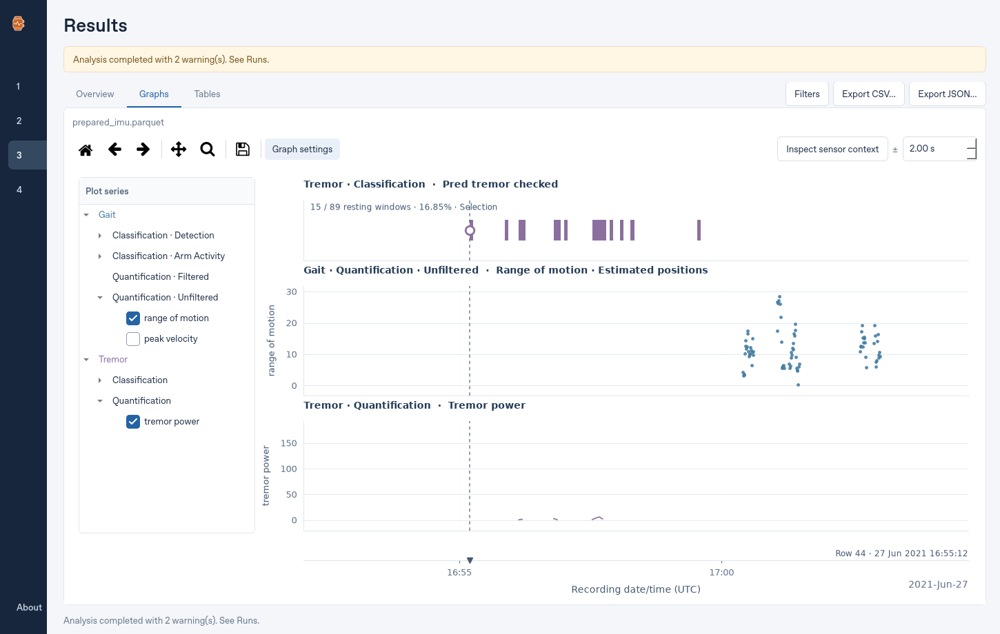

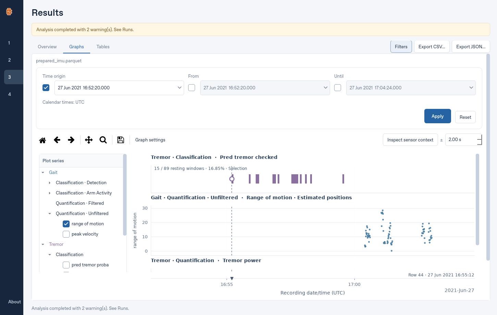

The [calendar popup](screenshots/calendar.png) has readable day headings. In
[compact windows](screenshots/results-filters-compact.png), the time fields wrap
onto two rows, or one field per row when wider native controls require it.
The Results workspace scrolls when its controls and graphs exceed the window height.

Tables uses Gait, Tremor and Pulse rate tabs. Each module's dropdown lists its classification, quantification and aggregation tables, including filtered/unfiltered branches where available. Original output columns and values are the default; **Timing details** optionally adds recording timestamps and gait timing annotations. Aggregation dictionaries retain their original keys/values in separate tables and CSV exports, covering the entire run rather than the selected time interval.

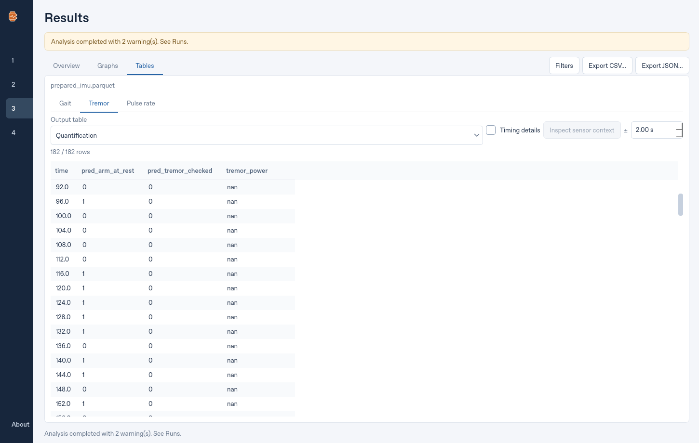

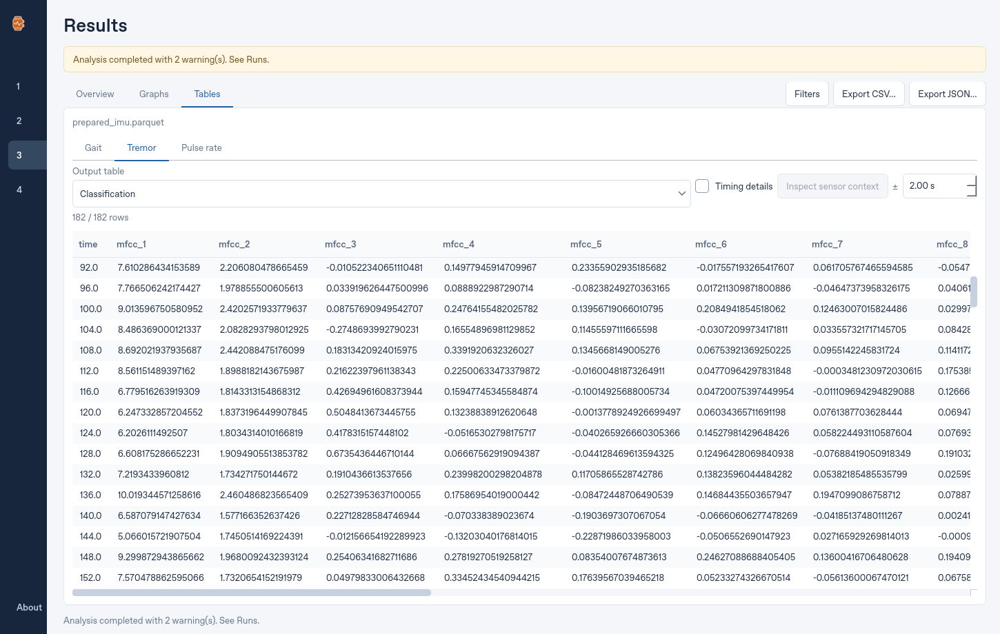

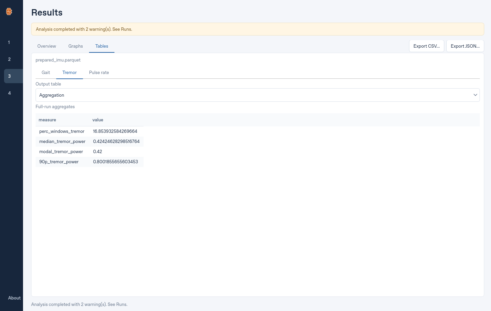

Sensor context opens in a full-size tab. In the prepared-IMU example, explicit gait-segment
metadata links a derived arm-swing result to original sensor samples. Drill-down
uses the entire recorded segment, rather than treating an estimated point as an
observed arm-swing timestamp. The CWA example can return a tremor aggregation
error when too few tremor windows are detected; available detail remains visible.

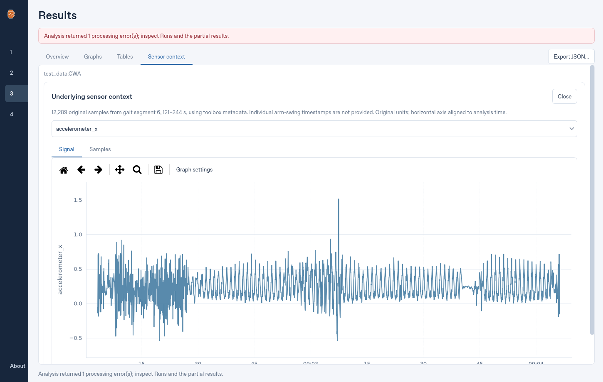

## Runs

Select a run to review status and its Parameters, Warnings, Errors, Outputs and Processing log tabs below the history list. Warning and error counts in the history list match their separate detail tabs. Partial results retain the failed modules’ errors; successful runs with warnings are labeled accordingly. Session results and explicitly exported JSON can be reopened here.

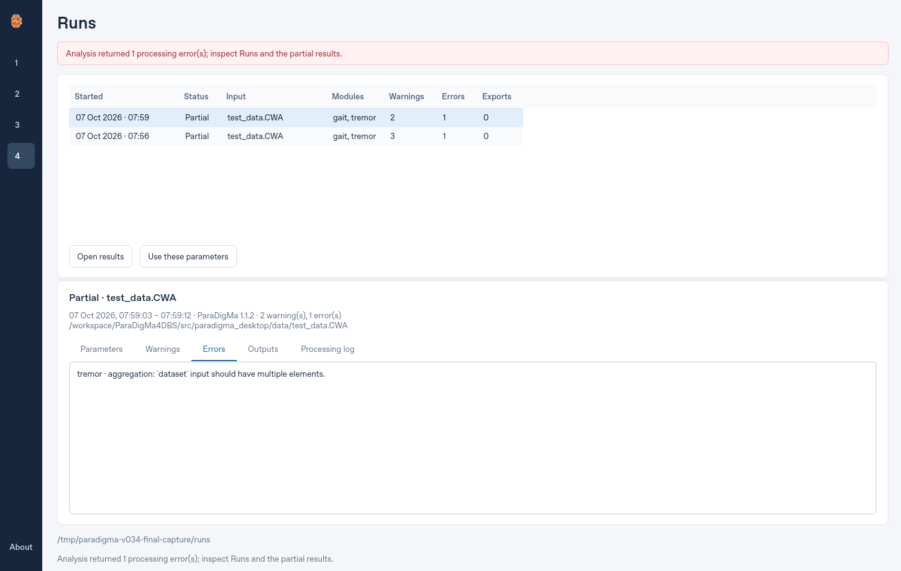

## Acknowledgement and citation

**About**, at the bottom of the sidebar and available on every page, credits the official ParaDigMa
authors and provides research references, a copyable BibTeX entry and the complete
upstream licence. Attribution files also accompany the executable.

## Compact layout

The sidebar starts collapsed and swiftly unfolds on hover. It overlays the page without shifting its controls and collapses when the pointer leaves. Navigation numbers, brand text and the left-aligned About button keep fixed positions throughout the animation; the subtitle stays on one line. The expanded width adapts to the system's font metrics so the text fits on Windows. Controls are integrated into each page, and settings persist while navigating.

[Sidebar expanded on hover](screenshots/sidebar-expanded.png)

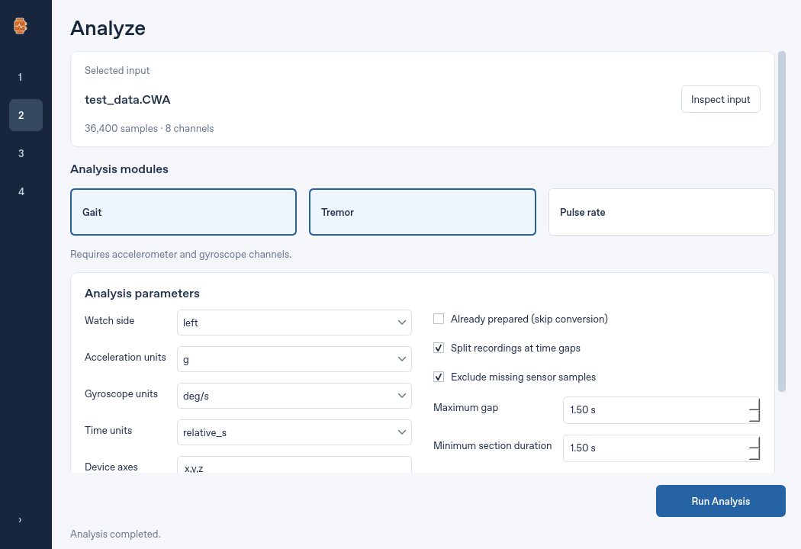

Dropdowns use dark text on white and white text on blue for the selected item,
including when the operating system uses a dark palette. The outer popup also
uses a white background, without dark strips above or below the list. Parameter
checkboxes use explicit borders and checkmarks. All table headings align left
and keep their full text, with horizontal scrolling for wider tables.

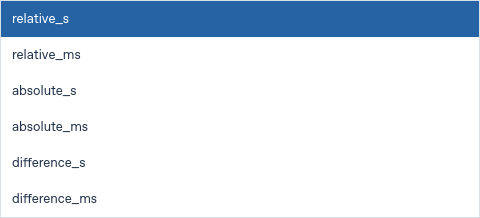

See the [README](../README.md) for file formats, input-unit requirements, local-history storage and executable download instructions.
